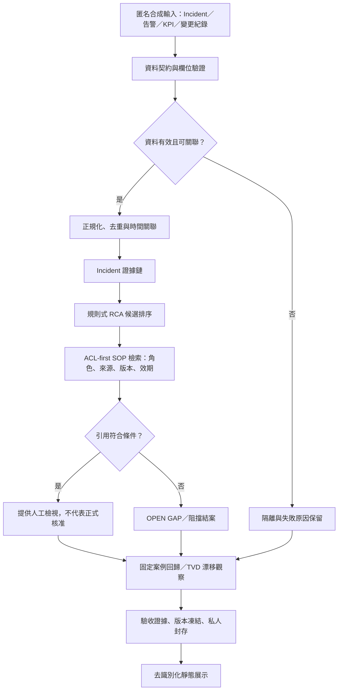

# AlaAkita AIOps｜電信維運工程實驗

> 從告警、KPI 與變更紀錄出發，建立可追溯、可重播、能安全停止的維運分析流程。

這是一項以 **4G LTE／5G NR、OSS／NOC 與 Python 自動化**為學習起點的技術實驗。我希望透過實際動手做，逐步理解資料品質、事件關聯、根因候選、SOP 引用及模型生命週期等技術，再將可重播的合成案例整理成離線模擬系統與公開展示網站。

本作品的核心不在「一鍵自動修復」，而在於：**一筆異常如何被確認、哪些資料能作為證據、為什麼提出某個候選原因，以及什麼情況下必須停止。**

**線上展示：**[GitHub Pages](https://alaakita-code.github.io/alaakita-aiops-experiment/) · [Cloudflare Workers](https://alaakita-aiops-experiment.alaakita.workers.dev/)

| 項目 | 目前版本與性質 |
| --- | --- |
| 本機核心模擬系統 | **v3.4**，已完成 Windows 實機驗收與正式結案；原始程式及證據私人封存 |
| 公開展示網站 | **v2.5**，靜態 HTML、匿名合成案例，可在手機及桌機操作 |
| 公開儲存庫 | 此儲存庫保存展示網站與經去識別化的技術說明，**不是**完整核心 Python 專案 |
| 正式網路操作 | **無**：不連線真實 OSS／NOC、基地台或網路設備，不自動核准、修復、部署或再訓練 |

---

## 1. 學習動機：為什麼要做這項實驗？

從熟悉的電信網路概念出發，嘗試學習如何用資料工程與自動化方法整理維運資訊。告警、基地台狀態、KPI、變更紀錄及測試結果，正好可以用來練習跨資料來源整合、事件關聯與品質驗證。

例如，假設 LTE 小區出現服務中斷，或 5G NR 的 SINR 與交遞表現異常，單靠告警名稱仍不足以判定原因。我想藉由模擬案例，練習比對事件識別、時間、KPI、變更紀錄與維護程序，理解一個判讀結論需要哪些證據。

實作時使用 Python、Shell 與試算表等工具，重點放在**可重複執行、錯誤處理、資料品質、結果可追溯與測試驗收**，並逐步練習將這些方法應用到 AIOps、資料工程與模型治理。

所有案例以合成資料建立，目的是練習設計方法與驗證流程，**不作為真實營運系統的效能或改善成果**。

### 要驗證的工程問題

1. **資料是否可信？** 缺欄位、重複紀錄、時間關聯不合理的資料，應在哪個階段被攔下？
2. **候選原因是否有依據？** 告警、KPI 與變更紀錄應如何建立關聯，避免把時間相近誤認為因果？
3. **SOP 能不能被引用？** 文件存在，不代表目前角色有權使用，也不代表來源、版本與有效期符合條件。
4. **版本能否安全交付？** 固定測試案例通過後，是否仍保留回歸阻擋、人工審核與正式部署的界線？

---

## 2. 技術架構與資料流程



流程刻意將**程式規則、候選判讀、人工確認與正式操作權限**分開。公開版的圖表及事件判斷是固定合成案例重播，不是即時 OSS 查詢、真正的模型訓練，亦不會啟動設備命令。

### 七個展示模組

| 模組 | 可操作或可觀察的內容 | 對應的工程目的 |
| --- | --- | --- |
| 實驗總覽 | 網路／事件關聯圖、統計指標、安全停損點 | 快速理解資料如何進入判讀流程 |
| 事件與告警 | 六筆合成 Incident、篩選、單筆與批次檢查、CSV／JSON 匯出 | 保留來源、原因候選與可追溯狀態 |
| 資料治理 | 欄位契約、去重、隔離原因、保留率與核對表 | 避免錯誤資料污染後續分析 |
| RCA 與檢索 | 規則式候選、來源參照、ACL-first 文件檢索 | 分清「可能原因」與「已證實根因」 |
| 模型生命週期 | 固定測試集、候選比較、TVD 漂移、治理節點 | 模擬變更前評估、回歸阻擋與人工審核 |
| SOP 安全閘門 | 合規引用檢查、兩筆 OPEN 缺口、補證流程 | 確保證據或授權不足時停止 |
| 驗收與發布 | Windows 既有驗收紀錄、私有封存、公用展示分工 | 保留測試事實及發布界線 |

---

## 3. 資料治理：先處理資料品質，再討論推論

實驗使用 40 筆刻意包含異常情況的合成來源紀錄。處理結果如下：

| 資料類型 | 原始筆數 | 有效筆數 |
| --- | ---: | ---: |
| Incident | 6 | 6 |
| 告警資料 | 17 | 11 |
| KPI 指標 | 14 | 10 |
| 變更紀錄 | 3 | 2 |
| **合計** | **40** | **29** |

另外記錄 **3 筆重複、8 筆隔離**，與 29 筆有效資料合計為 40 筆。整體有效保留率 **72.5%**；這是特定合成測試集的結果，不能推論真實電信場域的資料品質。

清洗與隔離流程依序執行：來源讀取、必要欄位與型別驗證、事件／站點／時間關聯檢查、重複資料排除、錯誤紀錄隔離及來源參照保留。隔離不只是刪除不合格資料，還要能回答**哪筆失敗、為何失敗、影響哪個後續流程**。

資料型別與時間戳的檢查採可重播的規則，讓後續 RCA 不會在來源欄位缺失的情況下產生看似合理的解釋。公開版的資料品質圖表是這組固定資料的示範，不是外部 API 即時匯入。

---

## 4. 事件證據鏈與 RCA：候選不等於結論

每筆 Incident 保留合成事件識別碼、無線技術別、觀察條件、來源引用、規則候選與 SOP 閘門狀態。例如：

| 合成事件 | 觀察情境 | RCA 候選 | 本次 SOP 狀態 |
| --- | --- | --- | --- |
| INC-1001 | LTE S1 傳輸路徑與小區服務中斷 | 傳輸異常 | 可供人工檢視 |
| INC-1002 | 5G NR SINR 下降與干擾告警 | 射頻干擾 | **待補證：ACL 不符** |
| INC-1003 | 變更紀錄後出現服務異常 | 組態差異 | 可供人工檢視 |
| INC-1004 | 維護時段內的小區不可用 | 計畫性維護 | **待補證：缺乏權威 SOP 來源** |
| INC-1005 | 供電狀態與小區不可用 | 電源異常 | 可供人工檢視 |
| INC-1006 | Xn 鏈路與交遞成功率異常 | Xn 連線 | 可供人工檢視 |

這些候選透過固定規則與合成證據建立關聯，不能當作真實故障的校準機率或已確認根因。**規則分數只用來排序，不代表故障機率。** 來源引用比單純產出一段自然語言摘要更重要，因為工程師必須能回到原始資訊核對。

### SOP 引用先檢查權限

檢索順序設計為：使用者／角色可見範圍 → 文件來源 → SOP 代碼與版本 → 有效期／契約 → 引用片段。**權限不足時不能藉由相似文件、重新檢索或模型摘要繞過限制。**

- **INC-1002：**合成 NOC 角色不符合所需 SOP 的 ACL，維持 OPEN。
- **INC-1004：**尚缺符合條件的權威 SOP 文件，維持 OPEN。

因此六筆案例中 **4 筆可供人工檢視、2 筆仍待補證**。前者不等於已授權正式處置；後者不能因測試介面通過而自動關閉。

---

## 5. 模型生命週期：用固定案例演練治理

這裡的「模型候選」是**離線自編預測結果與規則基準**，用來演練比較、漂移告警、回歸阻擋、人工審核及證據封存，**沒有在公開網站訓練、微調或部署 LLM**。

### 固定案例比較

- 候選 A：固定六筆案例 **6/6** 符合比較基準，可進入人工覆核；**不代表取得上線權限**。
- 候選 B：固定六筆案例 **0/6** 符合基準，標記回歸阻擋，不得升版。
- 此測試沒有獨立真實場域資料、完整模型訓練紀錄或機率校準，因此**不能宣稱 4G／5G 網路 RCA 準確率為 100%**。

### TVD 漂移觀察

使用五批合成歷史樣本展示分布差異（Total Variation Distance, TVD），人工待查門檻設定為 **0.30**。例如 BATCH-003 與 BATCH-004 連續超過門檻，其中 BATCH-004 的示例 TVD 約 **0.636**，因此標記人工審查。

**漂移告警不等於模型失效，更不應觸發自動再訓練或部署。** 應保留資料批次、候選版本、比較結果與人工決策紀錄，避免把同一次測試中的判讀結果反寫成新的固定基準。

### 治理節點

資料契約 → 固定測試集 → 候選比較 → 漂移觀察 → 人工審核 → 版本凍結 → 正式部署（本實驗禁止）→ 回饋再評估。每一步都要可回溯來源、判斷規則及阻擋條件。

---

## 6. 如何實際使用公開展示版？

不需要安裝 Python、後端服務或雲端付費資源。開啟下列任一網址：

- [GitHub Pages 作品展示](https://alaakita-code.github.io/alaakita-aiops-experiment/)
- [Cloudflare Workers 作品展示](https://alaakita-aiops-experiment.alaakita.workers.dev/)

建議依序操作：

1. **事件與告警**：選擇 INC-1001，使用「檢查目前事件」，查看來源與候選判斷。
2. 使用「一鍵檢查六筆」，確認結果為 **4 筆可供人工檢視、2 筆待補證**。
3. 以 LTE 或 5G NR 篩選事件，橫向查看 RCA 候選與 SOP 閘門；手機版事件 ID 固定在左側。
4. **資料治理**：確認 40 筆輸入、29 筆有效及隔離／去重統計。
5. **模型生命週期**：比較候選 A/B，觀察 TVD 批次圖與人工審核規則。
6. **SOP 安全閘門**：檢查 INC-1002 與 INC-1004 為何仍不能結案。
7. 需要留存合成實驗結果時，可使用網頁提供的 **CSV／JSON 匯出**。

> 「匯出全部 CSV」保留六筆合成事件資料；不要將篩選畫面看到的筆數直接當成匯出範圍。所有輸出皆為示範資料，並非真實設備或客戶紀錄。

此公開網頁也可將 `index.html` 以本機檔案方式開啟；不同 Android 版本及瀏覽器的檔案存取政策可能不同，因此仍應以實際裝置驗收下載與開啟結果。

---

## 7. 驗收事實與安全邊界

下表的核心驗收數字來自**已結案的 v3.4 Windows 實機執行紀錄**，不是靜態 HTML 重新執行 Python 測試的結果。

| 項目 | 已確認紀錄 | 解讀方式 |
| --- | --- | --- |
| 原始發行一致性 | `RELEASE SNAPSHOT PASS` | 原始 ZIP 與內部發行識別核對 |
| 一鍵驗收 | **18/18 PASS** | v3.4 本機整合及封存檢查 |
| pytest | **599 passed（248.90 秒）** | 原始 Windows 測試紀錄 |
| 凍結證據 | **92** | 既有驗收封存範圍 |
| 可攜性測試 | **87 JSON／26 Writers PASS** | 既有輸出一致性與寫入器驗收 |
| 安全關閉 | `BLOCKED / OPEN GAPS 2 / Exit 2` | **預期安全結果**，不是修復完成 |
| 真實網路操作 | **NONE** | 未對設備執行控制操作 |

**v3.4 的「開發與 Windows 驗收完成」，不等於「正式電信網路獲准部署」。** 兩筆 SOP 缺口仍存在，這是必須保留的事實，不應為了展示好看而修改成全部通過。

公開展示版 **v2.5** 已完成 Android 主要功能實機檢查，包括導覽、固定資訊列、事件單筆／批次檢查、表格捲動與 CSV／JSON 匯出。這與原始核心系統測試分屬不同層次；網站的發布同步與每次更新仍需個別核對。

---

## 8. 開發過程中遇到的工程問題

以下整理原始 Python 模擬專案在測試與跨平台驗證中處理過的技術問題，以及能沿用到其他專案的實作心得：

| 問題 | 原因與處理方向 | 可遷移的經驗 |
| --- | --- | --- |
| Windows Python 3.13 測試異常 | 在路徑替身中直接使用不適當的 `Path` 子類型，造成 pytest 收集或測試錯誤；改以 `PureWindowsPath` 等方式隔離模擬路徑 | 測試替身應模擬語意，不修改全域執行環境 |
| CP950 與 UTF-8 編碼衝突 | Windows 預設編碼讀取部分文字造成 `UnicodeDecodeError`；明確規範檔案編碼與失敗類型 | 將編碼視為輸入契約的一部分 |
| Windows／POSIX 路徑與換行差異 | 路徑分隔、JSON 序列化及換行可能影響 SHA-256；統一輸出表示法並驗證寫入器 | 雜湊驗證要求位元組層級一致，不只內容看起來相同 |
| 存在 SOP 不等於可引用 | ACL 不符或缺乏權威來源時，即使檢索結果看似相關也不能當作正式依據 | 存取控制必須早於檢索與摘要產生 |

在公開版的「驗收與發布」模組也保留了上述議題的技術說明。公開展示以可重播的技術步驟與驗證結果為主。

---

## 9. 發布架構與版本管理

此儲存庫中的公開網站採靜態 HTML 架構，無需資料庫、後端代理或外部 API 金鑰。**GitHub 作為公開展示內容的版本來源，Cloudflare Workers 使用對應版本的靜態資產。**

```text
公開儲存庫（可公開的內容）
├── index.html          # v2.5 展示網站，離線合成案例
├── README.md           # 技術實驗說明與使用方式
└── RELEASE_NOTES.md    # 之後版本可持續追加的變更紀錄（若建立）

私人封存（不放入公開儲存庫）
├── v3.4 原始 Python 發行檔
├── 完整 Windows 驗收日誌與證據
├── 本機／內部設定、路徑、憑證與環境資料
└── 未去識別化或不適合公開的原始附件
```

### 發布與驗證流程

1. 本機修改展示網站，保留版本識別與變更紀錄。
2. 在手機／桌機確認七個導覽、固定表頭、事件檢查、匯出及 SOP 阻擋。
3. 檢查公開檔案是否誤含個人識別資訊、金鑰、內部路徑或原始驗收日誌。
4. 更新 GitHub `main` 分支的公開檔案，透過 GitHub Pages 發布。
5. 依現有 Cloudflare **Workers** 部署設定，使用同一份公開 HTML 更新對應靜態資產；**Workers 不等同於 Pages，不能將 ZIP 當作 Worker JavaScript 程式直接上傳。**
6. 比對兩個線上入口的版本與內容雜湊，並各自做一次手機／桌機功能檢查。

目前公開入口：

- [GitHub Pages](https://alaakita-code.github.io/alaakita-aiops-experiment/)
- [Cloudflare Workers](https://alaakita-aiops-experiment.alaakita.workers.dev/)
- [GitHub 公開儲存庫](https://github.com/alaakita-code/alaakita-aiops-experiment)

### 版本區分

- **v3.4：**原始模擬軟體核心版本，已結案、不因網站外觀更新而改動。
- **v2.5：**本儲存庫展示網站版本，主要是 RWD、圖表、資料表、文字與操作體驗調整。
- **下一次展示版更新：**如有功能或文字變動，獨立紀錄版本、影響範圍、回歸測試與部署日期。

---

## 10. 技術限制與後續方向

這項實驗**可以展示**資料契約、告警關聯、規則候選、ACL-first SOP、固定測試、漂移觀察及安全停止設計；但**不代表**已建立真實電信場域的即時監控、已訓練 AI 故障模型、正式 SOP 核准、設備自動修復、MLOps 自動上線，或已量測真實 MTTR 改善。

接下來想繼續練習三件事：強化資料品質與來源契約、讓測試與驗收證據容易追溯，以及維持 GitHub／Cloudflare 公開版本一致。任何實際 OSS／NOC 接入與正式修復流程，都需要另外設計身分授權、監控代理、稽核及人工核准，不屬於目前公開展示版範圍。

---

**AlaAkita｜OSS／NOC 技術實驗**  
公開版僅使用匿名合成案例，完整核心驗收資料另行私人封存。
